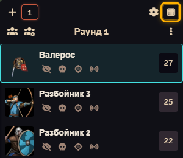
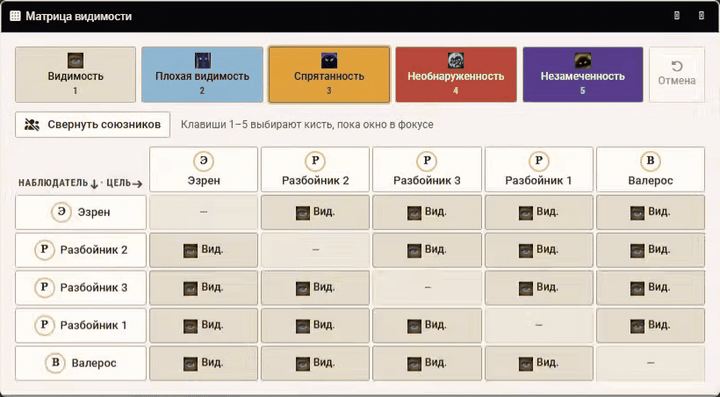
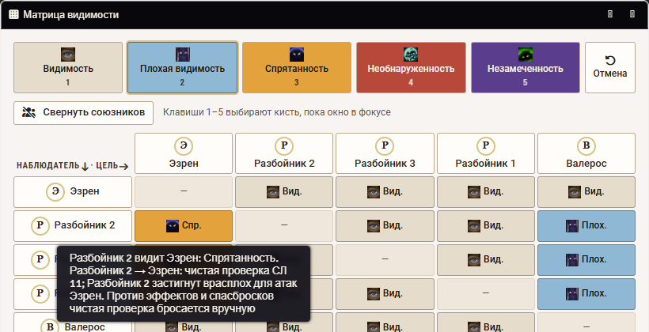
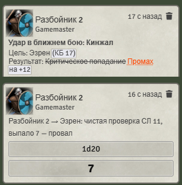
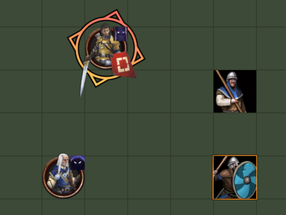
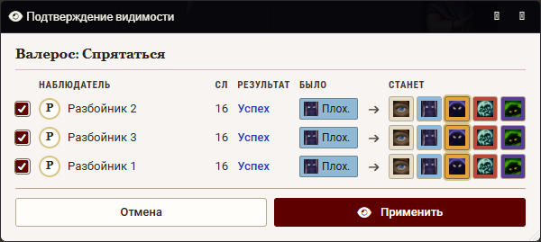
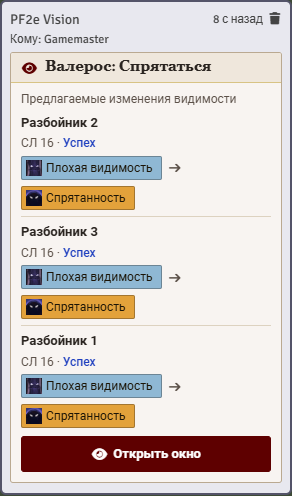
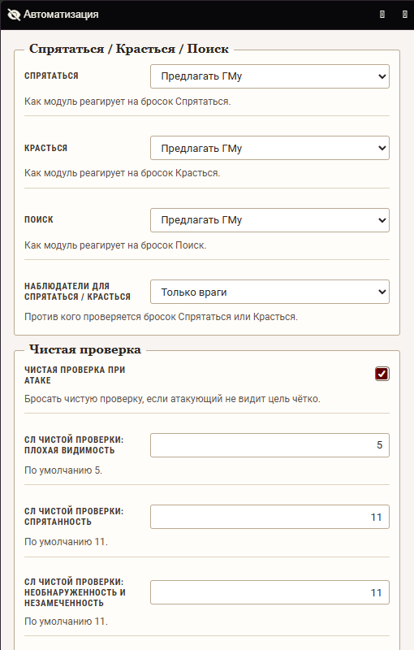

# PF2e Vision

**English.** Beta. A Foundry VTT v14 module for the PF2e system (8.1+). In an active combat the GM sets, per pair of tokens, how well each observer sees each target (Observed / Concealed / Hidden / Undetected / Unnoticed) in a "brush" matrix window. Players see the result on the canvas; attack rolls get flat checks and off-guard; Hide / Sneak / Seek rolls can propose or apply visibility changes. Requires lib-wrapper only. UI languages: Russian and English. The rest of this README is in Russian.

> **Тестовая версия 0.9.0. Перед установкой сделайте копию мира.**

## Что делает

Для участников активного боя ГМ выставляет направленную видимость «наблюдатель → цель» в окне-матрице. Игроки видят результат на канвасе (прозрачность, значок, скрытие токена). При броске атаки модуль бросает чистую проверку и делает цель «застигнутой врасплох» по правилам ниже. Броски Спрятаться, Красться и Поиск могут предлагать ГМу изменения видимости (окно подтверждения) или применять их сами.

## Требования

- Foundry VTT v14 (проверено на 14.370).
- Система PF2e 8.1.0 и новее (проверено на 8.7.0).
- Модуль lib-wrapper.
- PF2e Workbench и PF2e Toolbelt **не нужны**; модуль с ними совместим. Если в Toolbelt включён target-helper, его цели добавляются к целям Поиска.
- С [PF2e AuTOMATO](https://github.com/StompingRhino/pf2e-automato) работает в паре: дым, слепота и невидимость из его автоматизации ставят метки в матрицу Vision вместо состояний на актёре (настройка AuTOMATO «Метки видимости в PF2e Vision»).

## Установка

На экране настройки Foundry откройте вкладку «Модули», нажмите «Установить модуль» и вставьте в поле «Ссылка манифеста»:

`https://github.com/StompingRhino/pf2e-vision/releases/latest/download/module.json`

Затем включите в мире PF2e Vision и lib-wrapper.

## Как пользоваться

### Матрица видимости

Кнопка «Матрица видимости» — в шапке трекера боя (ряд кнопок над списком боёв). Окно только для ГМа. Строки — наблюдатели, столбцы — цели; в окне участвуют токены активного боя.

| Действие | Что происходит |
|---|---|
| Кисти 1–5 (палитра сверху) | Выбор уровня для закраски. Клавиши 1–5 работают, пока окно в фокусе (настройка «Клавиши 1–5 в матрице») |
| Клик по ячейке | Красит ячейку выбранной кистью |
| Протяжка | Зажать кнопку мыши и вести по ячейкам — красит все пройденные |
| Клик по имени наблюдателя | Красит всю строку: этот наблюдатель видит всех с выбранным уровнем |
| Клик по имени цели | Красит весь столбец: все видят эту цель с выбранным уровнем |
| «Отмена» | Откатывает последнее изменение |
| «Свернуть союзников» | Скрывает ячейки PC↔PC и NPC↔NPC. Критерий — «По союзу» или «По владельцу-игроку» |
| Подсказка при наведении на ячейку | Показывает последствия: чистая проверка СЛ N и/или «застигнут врасплох» |
| Подсветка | Наведение на имя или ячейку подсвечивает токены на канвасе |

### Уровни и последствия

Отношение направленное: как A видит B — не то же, что как B видит A. Ячейка (наблюдатель O, цель T) означает, как O видит T.

| Уровень | Чистая проверка у O при атаке на T (СЛ по умолчанию) | O застигнут врасплох для атак T? |
|---|---|---|
| Видимость | нет | нет |
| Плохая видимость | 5 | нет |
| Спрятанность | 11 | да |
| Необнаруженность | 11 | да |
| Незамеченность | 11 (как Необнаруженность) | да |

Кто бросает и кто застигнут:

- **Чистая проверка** — у атакующего, по уровню *цели для него* (как он видит цель).
- **Застигнут врасплох** — у цели атаки, если *атакующий для неё* Спрятан, Необнаружен или Незамечен (то есть ячейка «цель → атакующий» имеет такой уровень). Состояние учитывается и при расчёте попадания, и в броске урона (Скрытая атака и т. п.).

Провал чистой проверки по умолчанию делает атаку промахом; можно ограничиться сообщением в чат или отменить бросок. Результат чистой проверки идёт в чат публично или шёпотом ГМу (настройка).

Заклинания с атакой проверяются как атаки. Заклинания без броска атаки, сотворённые по целям (не по области), получают чистую проверку по каждой выбранной цели в момент сотворения. Проверка срабатывает только при настоящем сотворении (из заклинаний персонажа, свитка, жезла), а не когда заклинание просто показали в чат с листа. При провале в чат пишется, что заклинание не действует на эту цель; проверки идут в чат после карточки заклинания. Спасбросок и урон по такой цели блокирует PF2e AuTOMATO: модуль отмечает провалившие цели на карточке, а AuTOMATO не бросает по ним спасбросок и не наносит урон. Это работает только в паре с AuTOMATO и только для заклинаний, у которых есть его правило; без AuTOMATO (или для других заклинаний) проверка только сообщается, а родные кнопки PF2e остаются.

Стихийный взрыв кинетика получает «застигнут врасплох» в урон так же, как удары и заклинания.

### Что видят игроки

Относительно токенов, которыми игрок владеет (если их несколько — берётся самый «видимый» уровень):

- Плохая видимость и Спрятанность — токен полупрозрачный (степень задаётся настройками);
- Необнаруженность и Незамеченность — токен скрыт (можно отключить: тогда он показывается как спрятанный);
- значок уровня на токене (можно отключить).

У ГМа — необязательные значки относительно выделенных токенов.

### Автоматика Hide / Sneak / Seek

Для каждого действия режим: «Выкл.», «Предлагать ГМу» или «Применять автоматически». В режиме предложения у активного ГМа сразу открывается окно подтверждения: строка на каждую пару «наблюдатель (у Поиска — цель) — СЛ — результат — было — станет». «Станет» — ряд значков уровней, рассчитанный уровень выделен; галочка «Применить» стоит у строк с изменением. Наблюдатели без изменения тоже в списке (галочка снята) — ГМ может поправить и их. «Применить» записывает выбранные уровни, «Отмена» ничего не меняет. В чат ГМу приходит карточка-запись: до решения на ней кнопка «Открыть окно» (если окно закрыли или страницу перезагрузили), после применения — итог. Применить можно только из окна.

 

- Спрятаться: против наблюдателей, для которых цель не Спрятана и выше; успех даёт Спрятанность.
- Красться: для тех, для кого цель уже Спрятана или хуже; успех даёт Необнаруженность, провал — Спрятанность, критический провал — Видимость.
- Поиск: если у броска есть явные цели — проверяются только они. Если целей нет, ГМу и автору броска приходит карточка «Поиск: выбор области» со ссылками «Взрыв 15 фт» и «Конус 30 фт». Область выбирается после броска: нажмите ссылку и поставьте область на карту. Проверяются участники боя внутри области, спрятанные от искателя. Конус должен начинаться у ищущего (в его клетках или соседней клетке), иначе область удаляется с предупреждением; взрыв можно ставить где угодно. Расчёт идёт один раз, область после него удаляется, а ссылки на карточке заменяются надписью «Область выбрана». Игроку для постановки области нужно право создавать области на сцене, иначе её ставит ГМ. Успех: Спрятанность → Видимость, Необнаруженность → Спрятанность; критический успех — Видимость.

Наблюдатели для Спрятаться/Красться — только враги (по союзу) или все (настройка).

## Настройки

ГМ-настройки открываются кнопкой «Настроить автоматизацию» (окно «Автоматизация») в параметрах модуля. Остальные — обычные параметры модуля.

### Окно «Автоматизация»

**Спрятаться / Красться / Поиск**

| Название | По умолчанию | Что делает |
|---|---|---|
| Спрятаться | Предлагать ГМу | Реакция на бросок Спрятаться: выкл. / предлагать / применять автоматически |
| Красться | Предлагать ГМу | То же для Красться |
| Поиск | Предлагать ГМу | То же для Поиска |
| Наблюдатели для Спрятаться / Красться | Только враги | Против кого проверяется бросок: только враги или все |

**Чистая проверка**

| Название | По умолчанию | Что делает |
|---|---|---|
| Чистая проверка при атаке | вкл. | Бросать чистую проверку, если атакующий не видит цель чётко |
| СЛ чистой проверки: плохая видимость | 5 | СЛ для уровня «Плохая видимость» |
| СЛ чистой проверки: спрятанность | 11 | СЛ для уровня «Спрятанность» |
| СЛ чистой проверки: необнаруженность и незамеченность | 11 | СЛ для этих двух уровней |
| Провал чистой проверки | Атака — промах | Промах / только сообщение в чат / отменить атаку |
| Чьи атаки проверять | Все | Все / только персонажи игроков / только NPC |
| Сообщение чистой проверки | Публично | Публично / только ГМу (шёпот). При приватном броске атаки сообщение всё равно уходит шёпотом ГМу |
| Чистая проверка для заклинаний с целями | вкл. | Чистая проверка по каждой цели при сотворении заклинания без броска атаки; провал — только сообщение в чат |

**Застигнут врасплох**

| Название | По умолчанию | Что делает |
|---|---|---|
| Застигнут врасплох при атаке | вкл. | Цель, от которой атакующий спрятан, застигнута врасплох при расчёте попадания |
| Застигнут врасплох в уроне | вкл. | Передавать состояние в бросок урона (Скрытая атака, точный урон) |

**Очистка**

| Название | По умолчанию | Что делает |
|---|---|---|
| Очищать видимость в конце боя | вкл. | Удалять данные видимости с токенов при удалении боя и при удалении участника из боя; токены, ещё участвующие в активном бою, не очищаются |

### Параметры модуля (мировые)

| Название | По умолчанию | Что делает |
|---|---|---|
| Прозрачность: плохая видимость | 0,8 | Что видят игроки у токенов с плохой видимостью (0–1) |
| Прозрачность: спрятанность | 0,45 | Что видят игроки у спрятанных токенов (0–1) |
| Скрывать необнаруженных | вкл. | Скрывать от игроков необнаруженные и незамеченные токены |
| Скрывать необнаруженных в трекере боя | выкл. | Игроки не видят в трекере боя участников, которые необнаружены или незамечены для всех их токенов |
| Значок состояния | вкл. | Показывать игрокам значок видимости на токенах |

### Параметры модуля (клиентские, у каждого пользователя свои)

| Название | По умолчанию | Что делает |
|---|---|---|
| Значки для ГМа | вкл. | Показывать ГМу значки относительно выделенных токенов |
| Сворачивать союзников при открытии | выкл. | Сворачивать ячейки PC↔PC и NPC↔NPC при открытии матрицы |
| Кого считать союзниками | По союзу | Критерий сворачивания: по союзу / по владельцу-игроку |
| Клавиши 1–5 в матрице | вкл. | Выбор кисти цифрами, пока окно матрицы в фокусе |
| Подсказки последствий | вкл. | Показывать чистую проверку и «застигнут врасплох» при наведении на ячейку |
| Подсветка на канвасе | вкл. | Подсвечивать токены при наведении на имена и ячейки |

## Известные ограничения

- Освещение и стены не учитываются: уровни задаёт ГМ или автоматика по броскам.
- Настоящие условия PF2e Спрятан / Необнаружен на актёре работают отдельно от матрицы и с ней не синхронизируются.
- Данные хранятся флагами на токенах активного боя (`flags.pf2e-vision.visibility`); вне боя модуль не работает.
- Трекер боя по умолчанию показывает игрокам всех участников; скрытие необнаруженных включается настройкой «Скрывать необнаруженных в трекере боя».

## Нашли ошибку

Пишите в [Issues](https://github.com/StompingRhino/pf2e-vision/issues). Укажите версии Foundry, pf2e и модуля и приложите вывод консоли (F12).

Для разработчиков — `docs/dev/` (план, заметки по исследованию API, исходный бриф).

## Лицензия

Код модуля — MIT (`LICENSE`). Игровые механики и названия — Paizo Inc., используются по [Paizo Community Use Policy](https://paizo.com/licenses/communityuse) и ORC License (ремастер), полный текст уведомлений — `NOTICE`. Модуль не публикуется, не одобряется и не поддерживается Paizo.
